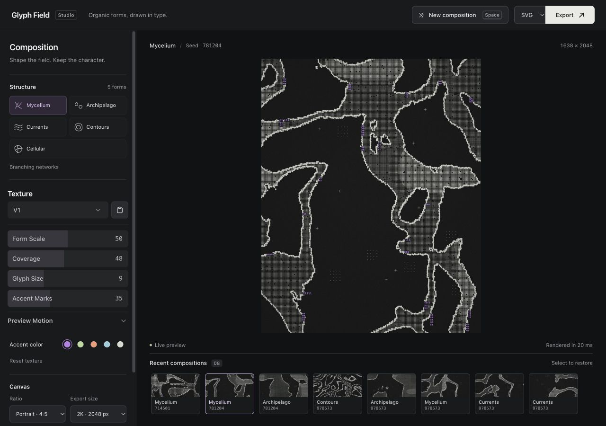

# Glyph Field

A fast, offline studio for generating organic ASCII artwork and glyph-drawn graphs. Open `index.html` in a modern browser. The included browser bundles work without an install, API key, server, or network requests.

The studio has two modes, switched at the top left:

- **Field** — organic glyph patterns, from full-canvas networks to single isolated shapes.
- **Graph** — seeded area charts drawn either in the Field glyph style or as pixel dither.



[Open the live studio](https://glyph-field.vercel.app) · [Download the offline tool](glyph-field-offline.zip) · [Example SVG](examples/mycelium-978573.svg)

## Run it

No install is needed to use the studio. Either open `index.html` directly, or serve the folder:

```bash
python3 -m http.server 4187
```

Then open http://localhost:4187. To change the React UI or rebuild bundles, see [Development](#development).

## Layout

The canvas sits on the left and the inspector on the right, with **Pattern**, **Colors**, and **Canvas** tabs. Under the canvas, a dock holds **Shuffle**, **Copy SVG**, the export format, and **Export**. On phones the controls stack below the canvas.

## Field mode

- Choose Mycelium, Archipelago, Currents, Contours, Cellular, or **Circles** for patterns that fill the canvas.
- Under **Isolated**, choose a single floating shape with negative space around it: **Organism** (one organic blob), **Drift** (a flowing ribbon with tapered ends), **Filament** (branching networks confined to an organic region), or **Colony** (scattered small fragments). Shuffle produces a new variation of the same shape type. Density sets the shape's size or thickness, and all texture and color controls still apply.
- **Circles** builds a pattern from repeated circular motifs. Choose **Symmetric grid**, **Staggered rows**, **Radial symmetry**, or **Asymmetric scatter**. Choose rings, filled circles, or concentric rings, then adjust **Circle size** and **Spacing**. Coverage adjusts ring weight. New composition varies glyph texture; scatter also varies circle positions and sizes. All settings persist and work with PNG/SVG and transparency.
- In **Frame**, choose Circle, Rounded box, Square, Diamond, Hexagon, Triangle, or Ring. **Freeform** keeps the original edge-to-edge compositions. Shapes stay proportional in every canvas ratio. This optional crop applies to the original organic structures; Circles uses its own repeated layout.
- Choose **Organic pattern** to contain the existing form inside the silhouette, or **Full glyph fill** for a continuous textured shape. Shape and fill persist in settings and apply to both PNG and SVG, including transparent exports. Structure and texture controls vary the interior; the silhouette stays fixed.
- **From image** rebuilds a PNG, JPG, or WebP made with Glyph Field as a new, editable composition, so older exports can become SVGs. Upload it or drop it on the canvas. The studio detects the background, glyph, and accent colors and the glyph size, then traces the shapes. Tune **Glyph size**, **Threshold** (grow or shrink shapes), **Smoothing** (outline tightness), and **Edge size**; **Compare with original** overlays your image at half opacity. Form scale, Letter marks, Shuffle, Frame, colors, and transparency all apply. The result matches the shapes and colors, not every glyph, because a PNG doesn't store the seed or settings. The image stays in memory only and is never uploaded anywhere.
- Click **Shuffle** or press **Space** outside a control for a fresh composition. This works in both modes.
- Adjust form scale, coverage, glyph size, and letter-mark quantity with the embedded DialKit controls. Arrow keys adjust a focused slider; Enter opens numeric entry.
- Open **Preview Motion** to tune a time-based spring, physics spring, or easing curve, replay the preview, or turn preview motion off. Motion feedback honors the system reduced-motion preference. Artwork accent controls remain beneath the texture controls.
- Set **Background color** and **Glyph color** independently in the Colors section. Glyphs retain subtle tonal variation for texture. **Reset colors** resets the whole palette; **Reset texture** leaves colors alone.
- Background, Glyph, and Accent each offer preset swatches plus a **+** button for any other color. Background: Aubergine `#201527`, Forest `#062916`, Midnight `#000011`, Burnt Ochre `#9A581F`. Glyph: Lilac `#B182C2`, Leaf `#65CC5C`, Copper `#C0752F`, Moss `#1D8414`, Silver `#ADADAD`. Accent: White `#FFFFFF`, Electric Violet `#8320C5`, Botanical Green `#3CA42C`, Burnt Ochre `#9A581F`. Presets apply their exact hex. The **+** button opens a custom color wheel with hue, saturation, brightness, and six-digit hex entry. Arrow keys also operate the wheel and sliders. All three colors persist in settings and are included in PNG/SVG exports. Older saved compositions receive the original background and glyph defaults.
- Enable **Transparent background** in Colors for PNG and SVG with real alpha transparency. The preview shows a checkerboard, which is never exported. Your background color is preserved while its picker is disabled; turn transparency off to restore it. Transparency is saved with settings, and **Reset colors** turns it off.
- Transparent exports omit the background, full-surface grain, and vignette so empty areas remain completely clear. Accent letters cut through the glyph field without opaque backplates. Filenames include `-transparent`.
- The interface branding stays black and white; artwork colors are independent.
- Pick portrait, square, landscape, or story format.
- Choose **PNG** or **SVG** beside **Export** in the toolbar. The format choice is remembered.
- **Copy SVG** in the dock puts the current composition on the clipboard as SVG markup, ready to paste into Figma, a code editor, or anywhere that accepts SVG. It uses the same output as an SVG export at your chosen export size.
- PNG exports have a 2048 px or 4096 px longest edge. SVG uses that nominal size with a scalable viewBox, editable text, vector marks, a vector grain pattern, and a gradient vignette. It contains no embedded bitmap.
- SVG glyphs remain text rather than outlined paths, so font appearance can vary across editors and operating systems. Composition settings are included in SVG metadata.
- Enter a seed to repeat a composition. Exact reproduction requires the same seed and all the same controls. Font rendering can vary between browsers and operating systems.

## Graph mode

Switch to **Graph** at the top left. Graphs share the seed, canvas ratio, export, and transparency with Field mode. Landscape 16:9 suits them best; on portrait canvases the chart height is capped so it still reads as a strip.

**Profile**

- **Curve** — Peaks, Ramp, Wave, Steps, Random walk, or Mixed (a random curve for each graph).
- **Height** — how tall the chart band is.
- **Roughness** — how busy the line is: more peaks, steps, or wobble.

**Series**

- **Graphs** — one graph by default. Raise it to 2–4 to compare several.
- **Layout** — **Side by side** (each graph in its own span) or **Layered** (graphs overlap on one baseline, back to front). Shown only with more than one graph.
- **Gap** — space between side-by-side graphs.

**Style**

- **Glyph field** (default) draws the chart with the Field engine. The area under the curve fills with Field glyphs, the top of the curve is traced with the `⊗ @` outline, and the base fades through an ordered dither to a flat baseline. Grain, vignette, and sparse crosshair and dot-grid marks carry over; letter fragments are left out.
- **Pixel dither** draws square pixel cells with a gradient fade, plus these extra options:
  - **Dither** — Ordered, Scatter, or Halftone.
  - **Cell** — Square, Gapped grid, or Round dots.
  - **Edge** — Bright, Solid, or no edge.
- **Glyph size** / **Pixel size** — size of each cell.
- **Falloff** — how quickly the fill fades toward the baseline.
- **Marks** / **Sparkle** — crosshairs and dot grids in Glyph style; scattered bright pixels in Pixel style.
- **Reset graph** restores the graph controls and leaves colors alone.

**Colors**

- Seven palette presets — Field, Reference, Sunset, Ocean, Toxic, Mono, and Candy — set every series at once.
- Each graph has its own color picker (**Graph color** for a single graph, **Series 1–4** for several). Background and transparency work as in Field mode.
- Switching style swaps between the Field and Reference palettes, but only while you haven't picked your own colors.

Exports work as in Field mode. Glyph-style SVGs keep glyphs as editable text; Pixel-style SVGs use one vector shape per cell. Graph filenames start with `glyph-field-graph-`.

## Style study

The reference combines a near-black charcoal ground; irregular, branching positive shapes; tiny monospaced texture zones; thick, pale `@` and ring-like edge glyphs; sparse enlarged violet letter fragments; and occasional crosshairs or dot arrays in the negative space. Composition is cropped at the edges, with substantial breathing room. This implementation approximates that visual language procedurally rather than reproducing the source pixel for pixel.

The renderer creates seeded, domain-warped noise fields, classifies foreground cells, finds their boundaries, stamps cached glyphs, and adds sparse accents and grain. Field functions produce distinct families within the same visual language; isolated forms add a distance falloff so a single shape floats in empty space, and glyph-style graphs supply a curve-shaped mask to the same pipeline. Generation time is measured and shown beneath the preview. Export rerenders at the chosen resolution.

## Files

- `index.html` — accessible studio controls and preview
- `style.css` — responsive layout
- `shapes.js` — shared geometry for canvas clipping and scalable SVG paths
- `trace.js` — reads an uploaded image back into a field: background and accent detection, glyph-size estimate, and a coverage mask
- `graph.js` — graph curves, series layout, the pixel-dither renderer, and the mask that feeds glyph-style graphs into the field renderer
- `app.js` — seeded renderer, export, saved settings, DialKit binding, and Motion feedback
- `vendor/` — local DialKit 2.2.0 and Motion 14.12.0 browser bundles, styles, and licenses
- `src/` — shadcn components, React control adapters, color picker, and color conversions
- `scripts/build-ui.mjs` — bundles the component UI and collects dependency license notices
- `scripts/sync-vendor.mjs` — refreshes DialKit and Motion browser bundles
- `scripts/build-static.mjs` — builds the `dist/` deployment; add any new top-level script to its file list

## Design verification

The studio applies Stageshow’s framing and spacing guidance, with an Emil Kowalski design-engineering pass for interaction polish. See `DESIGN-PLAN.md`, `POLISH.md`, and `REHEARSAL.md` for scope and verification.

## Development

`npm install` installs the UI and build dependencies. Run `npm run build` to refresh the offline bundles and create the static `dist/` deployment, `npm run check` for JavaScript syntax and TypeScript checks, `npm test` for color math and wheel-boundary checks, and `npm start` to serve the app. The renderer remains plain JavaScript. Small React roots host shadcn Button, Select, Popover, and Slider components with Lucide icons; esbuild and Tailwind produce local browser bundles. The compiled app still opens directly from `index.html` without a build server or network connection.

Generation and texture changes update immediately without fading the artwork. Pointer-driven structure selection uses an interruptible 180 ms highlight; keyboard actions remain instant. The export button keeps a fixed width through preparing and completed states. Motion settings persist alongside the composition. DialKit's version menu supports comparing parameter sets within the session.

## Vercel deployment

`vercel.json` uses `npm ci`, runs `npm run build`, and publishes only `dist/`. The build includes the app, its local libraries, examples, and the offline download. Source control metadata, installed npm packages, and local settings stay outside the deployment output.
