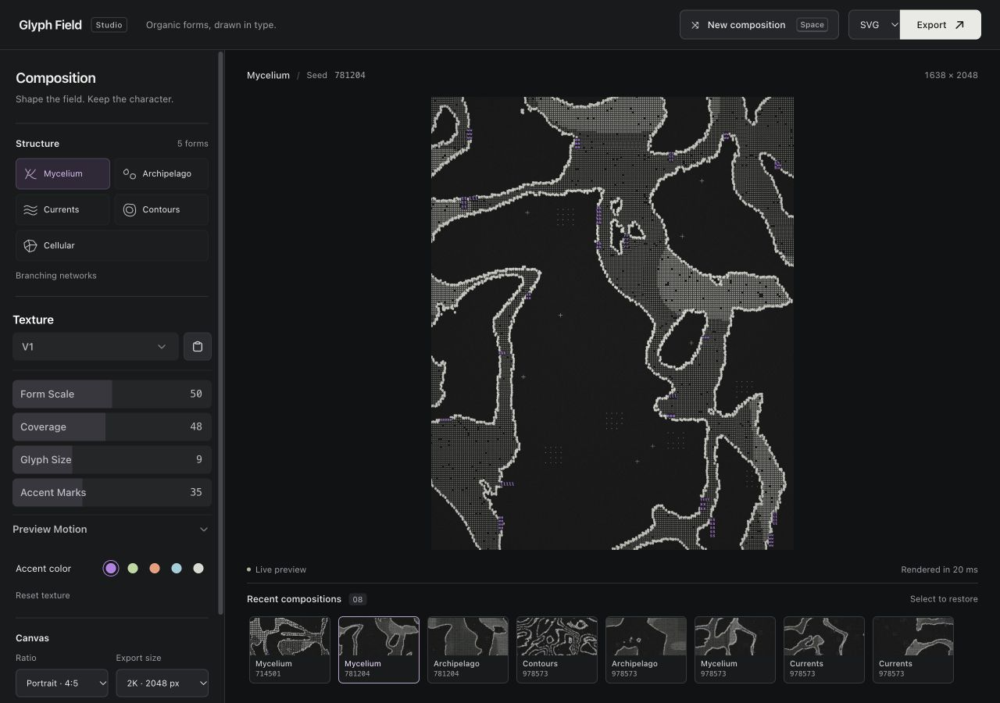

# Glyph Field

A fast, offline studio for generating organic ASCII artwork. Open `index.html` in a modern browser. The included browser bundles work without an install, API key, server, or network requests.

[Open the live studio](https://glyph-field.vercel.app) · [Download the offline tool](glyph-field-offline.zip) · [Example SVG](examples/mycelium-978573.svg)

## Use

- Choose Mycelium, Archipelago, Currents, Contours, Cellular, **Circles**, or **Spiral**.
- **Spiral** creates dotted winding trails inspired by a scattered, two-tone reference. Adjust turns, arms, scatter, dot size, dot density, accent mix, and direction. **Use reference palette** applies lavender dots, pink accents, and a light gray background; all three colors remain editable. The glyph picker becomes **Dot color** in this mode. Transparent PNG and editable-circle SVG exports preserve the same composition.
- **Circles** builds a pattern from repeated circular motifs. Choose **Symmetric grid**, **Staggered rows**, **Radial symmetry**, or **Asymmetric scatter**. Choose rings, filled circles, or concentric rings, then adjust **Circle size** and **Spacing**. Coverage adjusts ring weight. New composition varies glyph texture; scatter also varies circle positions and sizes. All settings persist and work with PNG/SVG and transparency.
- In **Frame**, choose Circle, Rounded box, Square, Diamond, Hexagon, Triangle, or Ring. **Freeform** keeps the original edge-to-edge compositions. Shapes stay proportional in every canvas ratio. This optional crop applies to the original organic structures; Circles uses its own repeated layout.
- Choose **Organic pattern** to contain the existing form inside the silhouette, or **Full glyph fill** for a continuous textured shape. Shape and fill persist in history and settings and apply to both PNG and SVG, including transparent exports. Structure and texture controls vary the interior; the silhouette stays fixed.
- Click **New composition** (**New** on mobile) or press **Space** outside a control for a fresh composition.
- Adjust form scale, coverage, glyph size, and letter-mark quantity with the embedded DialKit controls. Arrow keys adjust a focused slider; Enter opens numeric entry.
- Open **Preview Motion** to tune a time-based spring, physics spring, or easing curve, replay the preview, or turn preview motion off. Motion feedback honors the system reduced-motion preference. Artwork accent controls remain beneath the texture controls.
- Set **Background color** and **Glyph color** independently in the Colors section. Both offer the same color wheel, brightness controls, and hex entry. Glyphs retain subtle tonal variation for texture. **Reset colors** resets the whole palette; **Reset texture** leaves colors alone.
- Choose Monochrome, Violet, Sage, Ember, or Ice for the artwork accent. The **+** button opens a custom color wheel with hue, saturation, brightness, and six-digit hex entry. Arrow keys also operate the wheel and sliders. All three colors persist in settings and history and are included in PNG/SVG exports. Older saved compositions receive the original background and glyph defaults.
- Enable **Transparent background** in Colors for PNG and SVG with real alpha transparency. The preview and recent thumbnails show a checkerboard, which is never exported. Your background color is preserved while its picker is disabled; turn transparency off to restore it. Transparency is saved with settings/history, and **Reset colors** turns it off.
- Transparent exports omit the background, full-surface grain, and vignette so empty areas remain completely clear. Accent letters cut through the glyph field without opaque backplates. Filenames include `-transparent`.
- The interface branding stays black and white; artwork colors are independent.
- Pick portrait, square, landscape, or story format.
- Choose **PNG** or **SVG** beside **Export** in the toolbar. The format choice is remembered.
- PNG exports have a 2048 px or 4096 px longest edge. SVG uses that nominal size with a scalable viewBox, editable text, vector marks, a vector grain pattern, and a gradient vignette. It contains no embedded bitmap.
- SVG glyphs remain text rather than outlined paths, so font appearance can vary across editors and operating systems. Composition settings are included in SVG metadata.
- Revisit up to eight recent compositions. Settings and history persist locally when browser storage is available.
- Enter a seed to repeat a composition. Exact reproduction requires the same seed and all the same controls. Font rendering can vary between browsers and operating systems.

## Style study

The reference combines a near-black charcoal ground; irregular, branching positive shapes; tiny monospaced texture zones; thick, pale `@` and ring-like edge glyphs; sparse enlarged violet letter fragments; and occasional crosshairs or dot arrays in the negative space. Composition is cropped at the edges, with substantial breathing room. This implementation approximates that visual language procedurally rather than reproducing the source pixel for pixel.

The renderer creates seeded, domain-warped noise fields, classifies foreground cells, finds their boundaries, stamps cached glyphs, and adds sparse accents and grain. Five field functions produce distinct families within the same visual language. Generation time is measured and shown beneath the preview. Export rerenders at the chosen resolution.

## Files

- `index.html` — accessible studio controls and preview
- `style.css` — responsive layout
- `shapes.js` — shared geometry for canvas clipping and scalable SVG paths
- `app.js` — seeded renderer, export, local history, DialKit binding, and Motion feedback
- `vendor/` — local DialKit 2.2.0 and Motion 14.12.0 browser bundles, styles, and licenses
- `src/` — shadcn components, React control adapters, color picker, and color conversions
- `scripts/build-ui.mjs` — bundles the component UI and collects dependency license notices
- `scripts/sync-vendor.mjs` — refreshes DialKit and Motion browser bundles

To serve locally, run `python3 -m http.server 4187` from this directory and open `http://localhost:4187`.

## Design verification

The studio applies Stageshow’s framing and spacing guidance, with an Emil Kowalski design-engineering pass for interaction polish. See `DESIGN-PLAN.md`, `POLISH.md`, and `REHEARSAL.md` for scope and verification.

## Development

`npm install` installs the UI and build dependencies. Run `npm run build` to refresh the offline bundles and create the static `dist/` deployment, `npm run check` for JavaScript syntax and TypeScript checks, `npm test` for color math and wheel-boundary checks, and `npm start` to serve the app. The renderer remains plain JavaScript. Small React roots host shadcn Button, Select, Popover, and Slider components with Lucide icons; esbuild and Tailwind produce local browser bundles. The compiled app still opens directly from `index.html` without a build server or network connection.

Generation, texture changes, and history restoration update immediately without fading the artwork. Pointer-driven structure selection uses an interruptible 180 ms highlight; keyboard actions remain instant. The export button keeps a fixed width through preparing and completed states. History buttons keep their DOM identity and keyboard focus. Motion settings persist alongside the composition. DialKit's version menu supports comparing parameter sets within the session; recent image compositions continue to persist in the app's own history.

## Vercel deployment

`vercel.json` uses `npm ci`, runs `npm run build`, and publishes only `dist/`. The build includes the app, its local libraries, examples, and the offline download. Source control metadata, installed npm packages, and local settings stay outside the deployment output.
